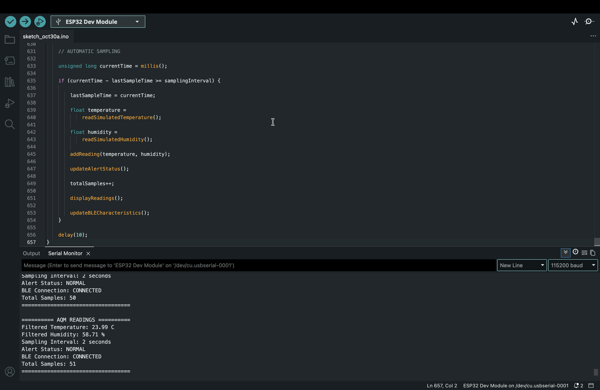
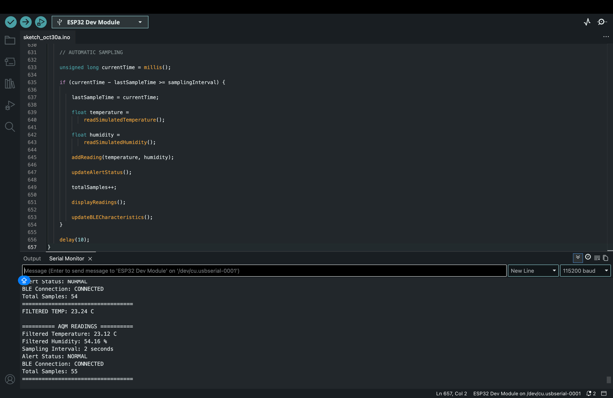
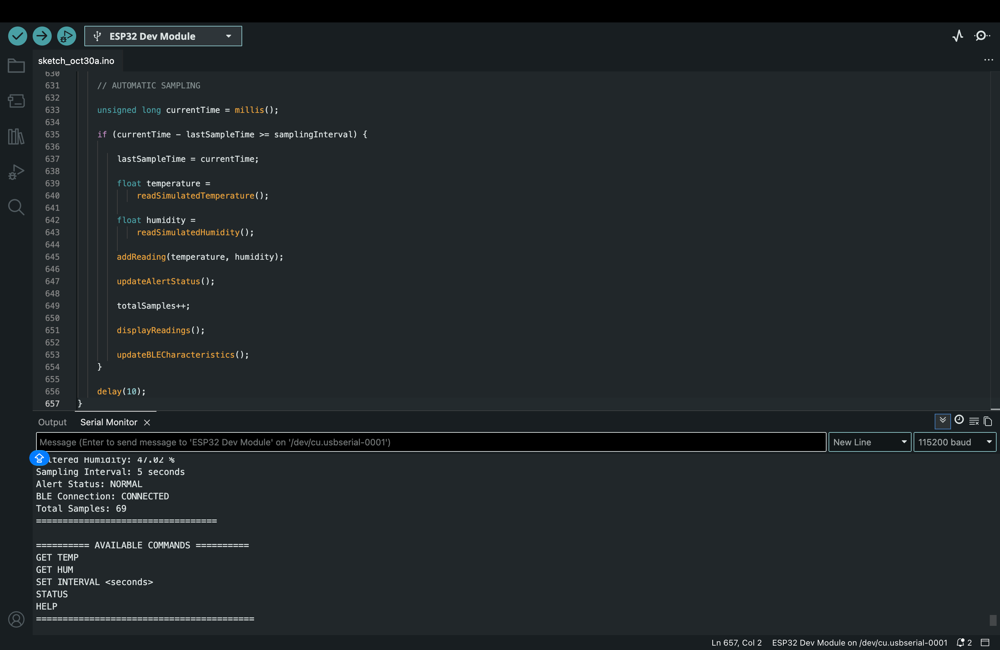

# AQM AETHER
### Smart Air Quality Monitoring System

**An ESP32-Based IoT Environmental Monitoring Prototype with Bluetooth Low Energy and Flutter Integration**

<p align="center">
  <b>ESP32 | C/C++ | BLE | Flutter | Dart | IoT</b>
</p>

---

## 1. Project Overview

**AQM AETHER** is an IoT-based environmental monitoring prototype designed to collect and monitor environmental sensor data using an ESP32 microcontroller.

The system integrates multiple sensors, including DHT22, MQ-2 and MPU6050, to acquire temperature, humidity, gas-related and motion measurements.

The collected sensor data is processed by the ESP32 and transmitted through Bluetooth Low Energy (BLE) to a Flutter-based Android application.

The application enables users to access sensor information wirelessly and monitor the connected device.

### Project Objectives

- Monitor environmental temperature and humidity.
- Collect gas and smoke-related sensor readings.
- Acquire accelerometer and gyroscope measurements.
- Establish wireless communication using Bluetooth Low Energy.
- Display sensor information through an Android application.
- Support configurable sensor sampling intervals.

---

## 2. Selected Track

| Parameter | Details |
|---|---|
| Project Name | AQM AETHER |
| Selected Track | ESP32 Hardware + BLE Mobile Application |
| Microcontroller | ESP32 DevKit |
| Programming Language | C/C++ |
| Communication Protocol | Bluetooth Low Energy (BLE) |
| Mobile Application | Flutter |
| Application Platform | Android |
| Simulation Platform | Wokwi |

*Note: Confirm that the selected track name matches the official competition track.*

---

## 3. System Architecture

AQM AETHER follows a sensor-to-microcontroller-to-mobile architecture.

```text
          ENVIRONMENT
               |
               v
       +----------------+
       |  SENSOR LAYER  |
       +----------------+
               |
       +-------+-------+
       |       |       |
       v       v       v
     DHT22    MQ-2   MPU6050
       |       |       |
       +-------+-------+
               |
               v
       +----------------+
       | ESP32 DevKit   |
       | Sensor Data    |
       | Acquisition    |
       +----------------+
               |
               v
       +----------------+
       | BLE SERVICE    |
       | Communication |
       +----------------+
               |
               v
       +----------------+
       | Flutter Android|
       | Application    |
       +----------------+
               |
               v
       +----------------+
       | Sensor Data    |
       | Visualization  |
       +----------------+
```

### System Workflow

1. Sensors collect environmental and motion-related measurements.
2. ESP32 reads the connected sensor values.
3. Sensor readings are processed and filtered where implemented.
4. ESP32 exposes sensor information through BLE characteristics.
5. The Flutter application scans for nearby BLE devices.
6. The application connects to the ESP32.
7. Sensor data is accessed through BLE characteristics.
8. Notifications provide updated readings for subscribed characteristics.

---

## 4. Hardware Components

The prototype uses the following hardware components.

| Component | Function |
|---|---|
| ESP32 DevKit | Main microcontroller and BLE communication |
| DHT22 | Temperature and humidity measurement |
| MQ-2 | Gas and smoke-related sensor readings |
| MPU6050 | Accelerometer and gyroscope measurements |
| Connecting Wires | Electrical connections |
| Power Supply | Powers the microcontroller and sensors |

### 4.1 Sensor Details

**DHT22 – Temperature and Humidity Sensor**

Measures:
- Ambient temperature in Celsius.
- Relative humidity in percentage.

**MQ-2 – Gas Sensor**

Provides analog readings associated with gas and smoke exposure.

Important: Raw ADC readings are not equivalent to calibrated gas concentrations in ppm.

**MPU6050 – Motion Sensor**

Provides:
- Three-axis accelerometer measurements.
- Three-axis gyroscope measurements.

### 4.2 Hardware Pin Configuration

| Component | Pin | ESP32 Connection |
|---|---|---|
| DHT22 | DATA | GPIO 4 |
| MQ-2 | Analog Output | GPIO 34 |
| MPU6050 | SDA | GPIO 21 |
| MPU6050 | SCL | GPIO 22 |
| MPU6050 | VCC | 3.3V |
| MPU6050 | GND | GND |

### I2C Configuration

| Parameter | Value |
|---|---|
| SDA | GPIO 21 |
| SCL | GPIO 22 |
| MPU6050 Address | 0x68 |

**Hardware Safety Note:** Verify the voltage requirements of each sensor module. Ensure the MQ-2 analog output voltage does not exceed the ESP32 ADC input limit.

### Circuit Diagram

Add your actual circuit diagram here.


---

## 5. Software and Technology Stack

| Technology | Purpose |
|---|---|
| C/C++ | ESP32 firmware development |
| Arduino IDE | Firmware development and uploading |
| ESP32 Arduino Core | ESP32 microcontroller support |
| Flutter | Android application development |
| Dart | Mobile application programming |
| Bluetooth Low Energy | Wireless sensor communication |
| Wokwi | Hardware simulation |
| nRF Connect | BLE discovery and testing |

### Required Arduino Libraries

- Adafruit DHT Sensor Library
- Adafruit MPU6050
- Adafruit Unified Sensor
- Adafruit BusIO
- ESP32-compatible BLE library

---

## 6. Bluetooth Low Energy Architecture

AQM AETHER uses Bluetooth Low Energy to establish wireless communication between the ESP32 and the Flutter application.

### BLE Device Information

| Parameter | Value |
|---|---|
| Device Name | AQM-Kamalesh |
| Communication | Bluetooth Low Energy |
| ESP32 Role | BLE Peripheral |
| Flutter Role | BLE Central |
| Service Type | Custom BLE Service |

### 6.1 BLE Service UUID

```text
12345678-1234-1234-1234-123456789001
```

### 6.2 BLE Characteristic UUIDs

| Characteristic | UUID | Intended Properties |
|---|---|---|
| Temperature | `12345678-1234-1234-1234-123456789002` | Read, Notify |
| Humidity | `12345678-1234-1234-1234-123456789003` | Read, Notify |
| Sampling Interval | `12345678-1234-1234-1234-123456789004` | Read, Write |
| Alert | `12345678-1234-1234-1234-123456789005` | Read, Notify |
| Gas Sensor | `12345678-1234-1234-1234-123456789006` | Read, Notify |
| Accelerometer X | `12345678-1234-1234-1234-123456789007` | Read, Notify |
| Accelerometer Y | `12345678-1234-1234-1234-123456789008` | Read, Notify |
| Accelerometer Z | `12345678-1234-1234-1234-123456789009` | Read, Notify |
| Gyroscope X | `12345678-1234-1234-1234-12345678900A` | Read, Notify |
| Gyroscope Y | `12345678-1234-1234-1234-12345678900B` | Read, Notify |
| Gyroscope Z | `12345678-1234-1234-1234-12345678900C` | Read, Notify |

*Important: Verify the actual properties in the final firmware before submission.*

### 6.3 BLE Communication Process

1. ESP32 initializes BLE.
2. The device starts advertising.
3. Flutter scans for nearby BLE devices.
4. The application identifies AQM-Kamalesh.
5. A BLE connection is established.
6. The application discovers the custom service.
7. Characteristics are accessed.
8. Sensor values are received.
9. Notifications provide updates where supported.
10. Sampling intervals can be modified through the writable characteristic.

---

## 7. Build and Run Instructions

### 7.1 ESP32 Firmware Setup

**Prerequisites**

- Arduino IDE
- ESP32 board support package
- Required sensor libraries
- ESP32 development board

**Installation Steps**

1. Install Arduino IDE.
2. Install ESP32 board support through Boards Manager.
3. Install the required sensor libraries.
4. Clone or download this repository.
5. Navigate to the firmware directory.
6. Open `AQM_AETHER.ino`.
7. Select the appropriate ESP32 board.
8. Select the correct serial port.
9. Connect the ESP32.
10. Upload the firmware.
11. Open Serial Monitor at 115200 baud.

### 7.2 Flutter Application Setup

**Prerequisites**

- Flutter SDK
- Dart SDK
- Android Studio or Visual Studio Code
- Android device with BLE support

Navigate to the application directory:

```bash
cd mobile_app
```

Install dependencies:

```bash
flutter pub get
```

Connect your Android device and execute:

```bash
flutter run
```

Grant the required Bluetooth permissions.

Start scanning and connect to the ESP32 device.

### 7.3 Generate Android APK

Execute:

```bash
flutter clean
flutter pub get
flutter build apk --release
```

Generated APK location:

```text
build/app/outputs/flutter-apk/app-release.apk
```

---

## 8. Testing Methodology

The project is evaluated through sensor initialization, firmware execution, BLE communication and mobile application integration.

### Testing Procedures

| Test | Testing Procedure | Expected Result |
|---|---|---|
| DHT22 | Read temperature and humidity | Sensor readings obtained |
| MQ-2 | Observe analog output | Gas sensor readings obtained |
| MPU6050 | Read accelerometer and gyroscope | Motion measurements obtained |
| ESP32 | Verify firmware initialization | Controller initializes |
| BLE Advertising | Scan using nRF Connect | ESP32 appears in scan results |
| BLE Connection | Connect to ESP32 | BLE connection established |
| Service Discovery | Discover custom BLE service | Characteristics are displayed |
| Notifications | Subscribe to supported characteristics | Updated values received |
| Sampling Interval | Change interval | Sampling configuration updated |
| Flutter Integration | Connect mobile application | Sensor information accessible |

### Testing Tools

- Arduino IDE Serial Monitor
- Wokwi Simulator
- nRF Connect for Mobile
- Flutter Android Application

### Serial Monitor Evidence

The following screenshots demonstrate firmware execution and sensor monitoring.








### BLE Connection Evidence

Add your actual nRF Connect screenshot here after successfully verifying the physical ESP32 BLE connection.


### Mobile Application Evidence

Add your Flutter application screenshot here.


---

## 9. Known Limitations

- MQ-2 provides raw analog readings and requires calibration before estimating gas concentrations.
- MQ-2 does not directly measure PM1.0, PM2.5 or PM10.
- Dedicated particulate matter sensors are required for PM measurements.
- Dedicated CO2 or VOC sensors are required for those measurements.
- DHT22 readings depend on environmental conditions and sensor response time.
- Wokwi simulation cannot fully validate physical sensor performance or real-world BLE connectivity.
- BLE performance depends on device compatibility, permissions and communication range.
- The current prototype is not a certified air-quality monitoring instrument.

---

## 10. Future Enhancements

Potential improvements include:

- Integration of PM1.0, PM2.5 and PM10 sensors.
- Addition of CO2 and VOC monitoring.
- Improved sensor calibration.
- Historical sensor data storage.
- Real-time graphical visualization.
- Configurable environmental alerts.
- Battery optimization.
- Extended wireless monitoring capabilities.

---

## 11. Repository Structure

```text
AQM-AETHER/
│
├── firmware/
│   ├── AQM_AETHER.ino
│   └── libraries.txt
│
├── mobile_app/
│   └── Flutter application source code
│
├── hardware/
│   ├── circuit_diagram.png
│   └── wokwi_diagram.json
│
├── documentation/
│   ├── AQM_AETHER_Technical_Documentation.pdf
│   └── AI_USAGE.md
│
├── screenshots/
│   ├── 01_aqm_sensor_readings.png
│   ├── 02_aqm_temperature_humidity.png
│   ├── 03_aqm_filtered_sensor_data.png
│   ├── 04_aqm_sampling_interval_update.png
│   ├── 05_aqm_system_status.png
│   ├── 06_aqm_serial_monitor_output.png
│   ├── ble_connection.png
│   └── mobile_app.png
│
├── demo/
│   └── AQM_DEMO.mp4
│
├── README.md
└── .gitignore
```

---

## 12. Project Resources

| Resource | Link |
|---|---|
| GitHub Repository | [AQM-AETHER](https://github.com/kamalesh151207/AQM-AETHER) |
| Wokwi Simulation | Add your public Wokwi project link |
| Demonstration Video | Add your video link |
| Technical Documentation | Add documentation file |

---

## 13. Conclusion

AQM AETHER demonstrates an IoT-based approach to environmental monitoring by combining ESP32-based sensor acquisition, Bluetooth Low Energy communication and a Flutter-based Android application.

The prototype establishes a foundation for wireless environmental data collection, configurable sampling and mobile sensor monitoring.

Future development will focus on expanding sensor capabilities, improving measurement accuracy and enhancing real-world monitoring performance.

---

**Project:** AQM AETHER  
**Domain:** Internet of Things (IoT)  
**Platform:** ESP32  
**Communication:** Bluetooth Low Energy  
**Mobile Application:** Flutter